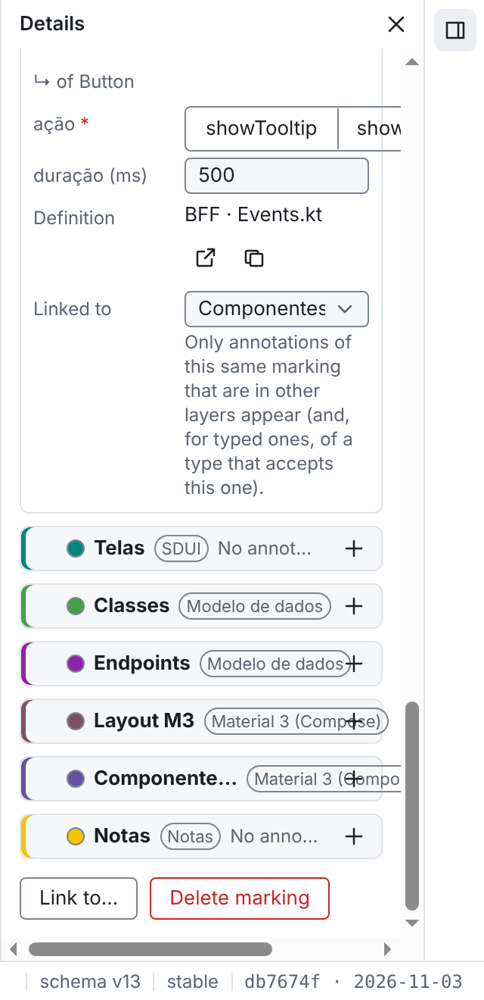

# Evidências de bugs

Branch órfão, só com imagens. Não tem código, não tem workflow, não vira PR e nunca é mesclado.

Cada bug do `fabianofranca/mapping` com evidência visual tem uma pasta com o número da issue: `<issue>/<nome>.png` (ex.: `371/painel-900px.png`). A issue mostra a imagem por

```markdown

```

Regras em `CLAUDE.md` ("Bugs e evidência visual").
